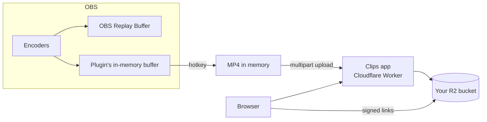

<div align="center">

# Better Clips

**Press a hotkey in a game. The last 30 seconds are in your browser a moment later.**

An OBS plugin that sends your replay buffer straight to your YouTube channel or
your own R2 or S3 bucket, without ever writing the clip to disk, and a fast web
app to watch, trim, keep and share what it uploads.

[](https://github.com/aarsh21/better-clips/releases/latest)
[](https://github.com/aarsh21/better-clips/actions/workflows/push.yaml)
[](https://github.com/aarsh21/better-clips/actions/workflows/web.yaml)
[](https://obsproject.com)
[](LICENSE)

[Install](#install) · [How it works](#how-it-works) · [The web app](web/README.md) · [FAQ](#faq) · [Contributing](CONTRIBUTING.md)


</div>

## Why

OBS's Replay Buffer writes every clip to disk, and then you still have to find
the file, upload it somewhere and copy a link. Better Clips skips all of that:

- **Skips the disk.** The plugin keeps its own replay buffer in memory,
  packages the clip as an MP4 in memory and uploads it in the background. A
  clip only touches disk if it can't be uploaded.
- **No extra encoding.** It reuses the frames OBS already encoded for its
  Replay Buffer, so it costs no GPU or CPU while you play.
- **Your storage, your clips.** Clips go to your own YouTube channel, R2
  bucket or S3 bucket. YouTube storage is unlimited; R2 has no egress fees and
  the first 10 GB a month are free.
- **Ready to share.** The MP4 has its index up front, so clips start playing
  instantly in the browser, and share links embed as video in Discord.

## Features

<table>
<tr>
<td width="50%" valign="top">

**In OBS**

- **Save Replay and Upload** hotkey and a dock next to Controls
- Upload to YouTube, an R2 bucket through the web app, or any S3 bucket
- Change the replay length live, without restarting the buffer
- Retries failed uploads, then saves the clip to your recording folder
- H.264, HEVC and AV1 video, AAC and Opus audio, every audio track
- One build works on OBS 31, 32 and 33
- One-line installer for Windows, macOS and Linux

</td>
<td width="50%" valign="top">

**In the web app**

- Clips grouped by day, with hover previews and search (`/` or `⌘K`)
- YouTube clips next to bucket clips: play, rename, cut, change visibility
- Lossless trimming in the browser, with no re-encoding
- Keep forever, trash, restore, rename, download
- Share links that expire after 1, 7 or 30 days, or never
- Automatic cleanup of old clips and the trash
- Light and dark themes, full keyboard control

</td>
</tr>
</table>

<table>
<tr>
<td width="50%"></td>
<td width="50%"></td>
</tr>
<tr>
<td align="center"><sub>The dock in OBS, right after an upload</sub></td>
<td align="center"><sub>Lossless trimming on a filmstrip</sub></td>
</tr>
</table>

## Install

**1. Install the plugin.** Run this in a terminal:

```sh
# macOS / Linux
curl -fsSL https://raw.githubusercontent.com/aarsh21/better-clips/main/install.sh | sh
```

```powershell
# Windows (PowerShell)
irm https://raw.githubusercontent.com/aarsh21/better-clips/main/install.ps1 | iex
```

The script waits for OBS to close and checks the new plugin before replacing
the installed copy. On upgrade it keeps the previous Better Clips version in
`plugin-backups`, beside OBS's `plugins` directory. If you
used Replay to R2, it removes that plugin too, and Better Clips keeps its
settings, sign-ins and hotkey. On Linux, only removing an old system-wide
install may need sudo; on Windows, it asks once for permission.

**2. Choose where clips go.** In OBS, open **Tools → Better Clips Settings** and
pick a **Destination**:

- **YouTube, directly.** Choose **Directly to YouTube**, click **Sign in with
  YouTube** and allow access in your browser. Clips upload to your channel as
  unlisted videos and the link is copied for you. Nothing else to set up.
- **The Better Clips app.** Sign in at
  [clips.zabimaru.me](https://clips.zabimaru.me) with Cloudflare, which creates
  an R2 bucket in your own account, or with Google for your YouTube clips. Then
  open **Settings → OBS** in the app and copy the install command shown there:
  it's the command above with your setup code built in, so it also connects
  OBS, turns on the Replay Buffer and binds **Ctrl+Alt+R**. For YouTube through
  the app, choose **YouTube → Through the Better Clips app** in OBS and sign in.
- **An S3 bucket.** See **Upload straight to a bucket** below.

**3. Play.** Enable the Replay Buffer in **Settings → Output**, bind **Save
Replay and Upload** in **Settings → Hotkeys** (the setup code does both for
you), and press it in a game.

Questions about YouTube, permissions or privacy? See the
[FAQ](https://clips.zabimaru.me/faq).

<details>
<summary><b>Install by hand</b></summary>

1. Download the package for your system from the
   [latest release](https://github.com/aarsh21/better-clips/releases/latest):
   the `.zip` for Windows, the `.pkg` for macOS, or the `.deb` for Ubuntu and
   Debian.
2. In OBS, open **Tools → Better Clips Settings** and choose a destination as
   in step 2 above. For the Better Clips app, click **Paste setup code**, then
   **Test Upload** and **Save**.
3. Enable the Replay Buffer in **Settings → Output**, and bind **Save Replay and
   Upload** in **Settings → Hotkeys**.

</details>

<details>
<summary><b>Host your own Better Clips app</b></summary>

The app runs free on Cloudflare Workers, and Cloudflare creates the R2 bucket for
you. Pick a password when it asks for `APP_PASSWORD`.

[](https://deploy.workers.cloudflare.com/?url=https://github.com/aarsh21/better-clips/tree/main/web)

Then open your app, sign in and click **Connect OBS** for an install command with
your setup code. A self-hosted app stores clips in its bucket; YouTube needs the
hosted app or direct mode. See [web/README.md](web/README.md) for details.

</details>

<details>
<summary><b>Upload straight to a bucket, without the app</b></summary>

The plugin can upload to any S3-compatible bucket. Create an R2 API token with
**Object Read & Write** for one bucket, then choose **S3 bucket** as the
**Destination** and fill in **S3 API URL**
(`https://<account-id>.r2.cloudflarestorage.com/<bucket>`), **Access Key ID**
and **Secret Access Key**.

</details>

### Requirements

| | Supported |
|---|---|
| OBS | 31, 32 and 33 |
| Windows | 10 and 11, x64 |
| macOS | 12 or newer, Apple Silicon and Intel |
| Linux | x86_64, OBS from your distro or the OBS PPA (Flatpak OBS isn't supported yet) |
| Video encoders | Anything that outputs H.264, HEVC or AV1: x264, NVENC, AMF, Quick Sync, Apple VT, SVT-AV1 |
| Audio encoders | AAC or Opus |

## How it works



1. When OBS's Replay Buffer starts, the plugin attaches a second output to the
   same encoders. It keeps the same length and size limits as OBS's buffer
   (**Settings → Output**) and keeps whole groups of pictures, so a clip always
   covers at least the length you set.
2. On the hotkey, it copies the buffered packets and writes an MP4 itself.
   There's no FFmpeg involved, which is why one build loads on every supported
   OBS version. On a 4-core machine, a 60-second 1080p60 clip at 40 Mbps
   packages in about 0.2 s, roughly 3× faster than FFmpeg's MP4 muxer.
3. It uploads the MP4 in 50 MB parts through your clips app, which checks the
   upload token and writes to R2. The upload runs on its own thread and never
   blocks OBS.
4. Clips are named by day, time and the app you were using (usually the
   game), such as `replays/2026-11-24/14-35-07_Valorant.mp4`; the app is the
   clip's category in the web app. When OBS itself is focused, or on Linux
   desktops other than Hyprland, the scene name is used.

The app is a single Cloudflare Worker next to your bucket, so bucket keys never
reach the browser. See [web/README.md](web/README.md) for its design, bucket
layout and deployment options.

## FAQ

<details>
<summary><b>What happens if my internet drops while saving?</b></summary>

The plugin retries for about 2 minutes. If every retry fails, it saves the clip
to OBS's recording folder (**Settings → Output**) instead, as
`Replay 2026-11-24 14-35-07_Valorant.mp4`, and the status bar shows where. Up to
3 clips wait to upload at once; if you save more while they're stuck, the extra
ones go straight to the recording folder. Clips that are still uploading when you
close OBS are saved there too.

</details>

<details>
<summary><b>Does it slow down my game or stream?</b></summary>

No extra encoding happens: the plugin reuses OBS's encoded frames. Packaging
and uploading run on a background thread. The clip is briefly held twice in
memory while it's packaged (about 90 MB for a minute at 12 Mbps), then the
buffered frames are freed.

</details>

<details>
<summary><b>Does OBS's own Save Replay still work?</b></summary>

Yes. OBS's **Save Replay** button and hotkey still save a file as usual. The
plugin adds its own button and hotkey next to them.

</details>

<details>
<summary><b>The hotkey only works while OBS is focused (Hyprland and other Wayland desktops)</b></summary>

Wayland only sends key presses to the focused window, and OBS has no global
hotkey support there yet
([obs-studio#10538](https://github.com/obsproject/obs-studio/issues/10538)).
On Hyprland, keep your key bound to **Save Replay and Upload** in OBS
(Ctrl + Alt + R below) and let Hyprland pass it to OBS:

```lua
-- Hyprland 0.55 or newer (Lua config)
hl.bind("CTRL + ALT + R", hl.dsp.pass({ window = [[class:com\.obsproject\.Studio]] }))
```

```ini
# Older Hyprland (hyprland.conf)
bind = CTRL ALT, R, pass, class:^(com\.obsproject\.Studio)$
```

If nothing happens, check OBS's window class with `hyprctl clients`.

Alternatively, install
[obs-wayland-hotkeys](https://github.com/leia-uwu/obs-wayland-hotkeys) (AUR:
`obs-wayland-hotkeys-git`), which registers OBS's hotkeys with the
GlobalShortcuts portal. It needs `xdg-desktop-portal-hyprland`. Assign a key in
the dialog it shows when OBS starts, find the shortcut's name with
`hyprctl globalshortcuts`, and bind it with Hyprland's `global` dispatcher. See
the [Hyprland wiki](https://wiki.hypr.land/configuring/core/binds/globals/).

</details>

<details>
<summary><b>Which format makes the smallest clips?</b></summary>

The plugin doesn't re-encode, so size depends only on your OBS encoder
settings; the MP4 container adds about 0.03%. AV1 gives the smallest files for
the same quality, and a quality-based rate control (CQP or QVBR) saves more than
CBR on quiet scenes. Note that older iPhones and Macs can't play AV1.

</details>

<details>
<summary><b>How much does it cost?</b></summary>

The Worker fits in Cloudflare's free plan. R2 includes 10 GB of storage a month
for free, then about $0.015 per GB a month, and downloads are always free. The
app deletes new clips after 30 days and the trash after 7 by default; change
that in **Settings → Storage**. Clips you keep stay.

</details>

<details>
<summary><b>Can I hide something by trimming before I share?</b></summary>

Not reliably. Trims aren't re-encoded, so the file starts at the keyframe before
your in point, and up to a couple of seconds before it are still in the file.

</details>

## Building

The plugin is based on
[obs-plugintemplate](https://github.com/obsproject/obs-plugintemplate) and needs
libobs, obs-frontend-api, Qt 6 and libcurl.

```sh
# Debian / Ubuntu
sudo apt install obs-studio libobs-dev qt6-base-dev libcurl4-openssl-dev libsecret-1-dev cmake ninja-build pkg-config
cmake --preset ubuntu-x86_64
cmake --build build_x86_64
```

For Windows and macOS, use the `windows-x64` and `macos` presets, or push to a
fork and let GitHub Actions build all three. The web app lives in [`web/`](web)
and builds with `pnpm install && pnpm build`.

## Contributing

Bug reports, ideas and pull requests are welcome. Read
[CONTRIBUTING.md](CONTRIBUTING.md) for how the project is laid out and what the
checks expect, and [SECURITY.md](SECURITY.md) to report a vulnerability
privately.

## License

[GPL-2.0](LICENSE), like OBS itself. Not affiliated with OBS Project or
Cloudflare.
